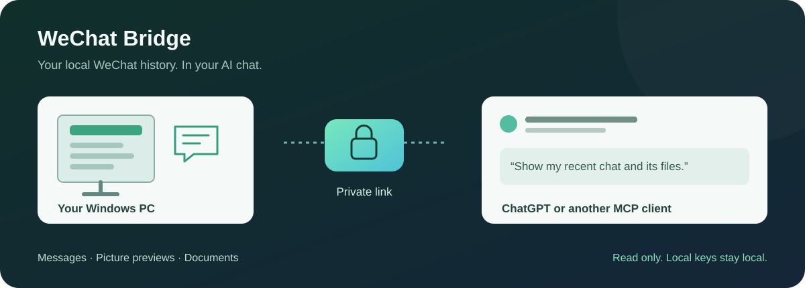

# WeChat Bridge

[](https://github.com/zakir300408/wechat-bridge/actions/workflows/ci.yml)
[](LICENSE)



Read your own local WeChat history from ChatGPT or another remote MCP client.

**Windows preview · read-only · MIT licensed**

WeChat Companion runs on the Windows PC containing your WeChat data. It connects outward to a Cloudflare gateway and gives you a private MCP link. Add that link to your chat app once. You do not need an OpenAI tunnel or your own Cloudflare account to use the hosted gateway.

> Early preview, not an independently audited security product. The private link is a credential: anyone with it can read through the four exposed tools while the companion is connected. Keep it private and use **Reset private link** if it is exposed.

## Get started

1. Install [Node.js](https://nodejs.org/) 22.13 or later on the Windows PC containing your WeChat history.
2. Run this in PowerShell:

   ```powershell
   npx @zakir300408/wechat-companion@latest setup
   ```

3. Follow the companion's local WeChat initialization if needed. It can require a WeChat login; never upload database keys or copy another PC's credentials.
4. Click **Copy private link** on the connection page. In ChatGPT, add a custom MCP server with that link and select **No authentication**. The link supplies the credential; this is not a public, unauthenticated reader.

Keep the source PC awake, online, and running the companion. Other PCs used only to browse ChatGPT do not need the reader installed. Each additional source PC needs its own installation and link.

The `latest` npm package and this repository's next preview may differ. This tree prepares `0.6.0-preview.1`; it is not a claim that this version has been published. For a source build, use [Development](docs/DEVELOPMENT.md).

**Want ChatGPT to guide you?** Copy the prompt in [Assistant setup guide](docs/ASSISTANT_SETUP.md). It tells the assistant how to help without requesting your private link, keys, screenshots, or chat exports.

## What it can do

| Capability                                                          | Status                                                             |
| ------------------------------------------------------------------- | ------------------------------------------------------------------ |
| Find contacts by saved remark, nickname, WeChat ID or stored pinyin | Supported; ambiguous names return candidates                       |
| Read messages in an explicit time window                            | Supported, with pagination and source identifiers                  |
| View locally retrievable pictures                                   | Supported as image previews; original resolution is not guaranteed |
| Download message-linked files                                       | Temporary links, up to 30 MiB, while the source PC is online       |
| Extract PDF, DOCX, XLSX and text                                    | Supported; no separate OCR pipeline                                |
| Transcribe voice messages                                           | Not configured; no transcript is invented or model downloaded      |
| Send messages or automate the WeChat screen                         | Not exposed                                                        |

Local history can be incomplete or unavailable. Empty results do not prove that nothing was said. Media links expire after ten minutes; source restarts also invalidate their in-memory handles.

## Choose your guide

- [Install and connect](docs/SETUP.md)
- [Guide for a setup assistant](docs/ASSISTANT_SETUP.md)
- [Troubleshooting](docs/TROUBLESHOOTING.md)
- [Privacy and trust boundaries](PRIVACY.md)
- [Security policy and threat model](SECURITY.md)
- [Self-host the gateway](docs/SELF_HOSTING.md)
- [Development and tests](docs/DEVELOPMENT.md)
- [Release process](docs/RELEASING.md)
- [Security review and remaining work](docs/SECURITY_REVIEW.md)

## How it works

```text
ChatGPT / MCP client
        │ HTTPS + private link
        ▼
Cloudflare gateway ── authenticated outbound WebSocket ── Windows companion
                                                               │
                                                        Local WeFlow reader
                                                               │
                                                      Your local WeChat data
```

The gateway enforces a four-tool allowlist and per-PC credentials. Local agent credentials manage pairing and revocation; a remote read credential cannot delete a device or rotate its link. Database keys remain on the source PC. Requested content passes through Cloudflare and the selected chat provider; this is not end-to-end encryption against either provider.

## Compatibility and limits

- Windows source PCs only. The native launcher is unsigned.
- WeFlow is pinned to `1.21.15`. Its internal APIs are a compatibility risk. WeChat updates can break access.
- A previous local test worked with WeChat 4.2.0.13; this is not a guarantee for all installations. A clean second-PC installation remains a release-validation item.
- One link targets one PC/account. There is no central user account, multi-PC picker, automatic cross-PC history merge or public plugin-directory listing.
- The gateway targets Cloudflare's Free-plan features, subject to quotas and the operator's actual account/billing settings. ChatGPT eligibility and any future speech/model API costs are separate.

## Contributing

See [CONTRIBUTING.md](CONTRIBUTING.md). Please use synthetic fixtures. Do not submit real messages, contact indexes, database keys, private links, media, or local account configuration in issues or pull requests.

Our code uses the [MIT license](LICENSE). Dependencies retain their own licenses; see [THIRD_PARTY_NOTICES.md](THIRD_PARTY_NOTICES.md).
