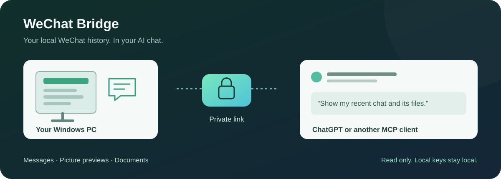

# WeChat Bridge

[English](README.md) · 简体中文

在 ChatGPT 中查看你的微信聊天记录、图片和文件。



## 安装

在平时使用微信的 Windows 电脑上，安装 [Node.js](https://nodejs.org/zh-cn/) 22.13 或更新版本，然后打开 PowerShell，运行：

```powershell
npx @zakir300408/wechat-companion@latest setup
```

如果出现微信初始化窗口，按提示完成操作。在连接页面点击 **Copy private link**，将链接添加到 ChatGPT 的自定义 MCP 服务器设置，认证方式选择 **No authentication（无需认证）**。

请保管好这个链接。桥接程序连接期间，持有链接的人可以读取你的聊天记录。

> npm 目前发布的是 **0.5.0**，会显示一个应用窗口。下方介绍的托盘版本是 **0.6.0-preview.2**，目前可[从源码运行](docs/DEVELOPMENT.md)，尚未发布到 npm。

## 安装之后

新版会在系统托盘中运行，并随 Windows 登录自动启动，不需要一直开着窗口。双击托盘图标可打开连接页面；右键菜单可以断开连接、重置链接或关闭开机启动。

这台电脑需要保持唤醒并联网。你可以在另一台电脑或手机上使用 ChatGPT，无需在那里安装桥接程序。如果要读取另一台电脑本地的微信记录，需要在那台电脑上单独安装，每台电脑都有自己的连接链接。

可以这样问：

- “总结一下我上周和小张聊了什么。”
- “给我看看我最后发给小张的图片。”
- “找到小张昨天发来的 PDF。”

## 支持什么

- 按备注名、昵称、微信号或已保存的拼音查找联系人。
- 读取本地聊天记录、查看图片。
- 下载聊天中的文件，最大 30 MB，下载链接十分钟后失效。
- 提取 PDF、Word、Excel 和文本文件中的文字。

图片清晰度取决于微信在这台电脑上保存的文件。如果只有缩略图，请先在微信中打开图片并下载原图，再试一次。

暂不支持语音转文字或发送消息。无法读取只保存在其他设备上的记录。

## 隐私

数据库密钥保留在你的电脑上。你请求的消息和文件会经过我们的 Cloudflare 服务器及你使用的聊天服务，使用前请确认你信任这些服务。

桥接程序连接期间，持有私有链接的人可以读取记录。如果链接泄露，请在托盘菜单选择 **Reset private link（重置链接）**。选择 **Disconnect（断开连接）** 或 **Quit（退出）** 可以停止访问。

这是 Windows 早期版本，程序尚未签名，也未经过独立安全审计。微信更新可能导致功能失效。更多信息见[隐私说明](PRIVACY.md)和[安全说明](SECURITY.md)（英文）。

## 帮助与开发

[中文安装帮助](docs/SETUP.zh-CN.md) · [故障排查](docs/TROUBLESHOOTING.md) · [让 ChatGPT 帮你安装](docs/ASSISTANT_SETUP.zh-CN.md)

[从源码运行](docs/DEVELOPMENT.md) · [部署自己的服务器](docs/SELF_HOSTING.md) · [参与贡献](CONTRIBUTING.md)（开发文档为英文）

使用我们托管的服务器，不需要 OpenAI 隧道或自己的 Cloudflare 账号。聊天服务需要支持自定义 MCP 服务器，其账号要求及费用另行适用。

基于 [WeFlow](https://github.com/zhuobichen/weflow-cli) 构建，采用 [MIT 许可证](LICENSE)。
